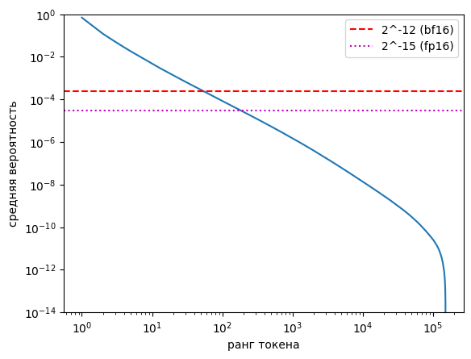
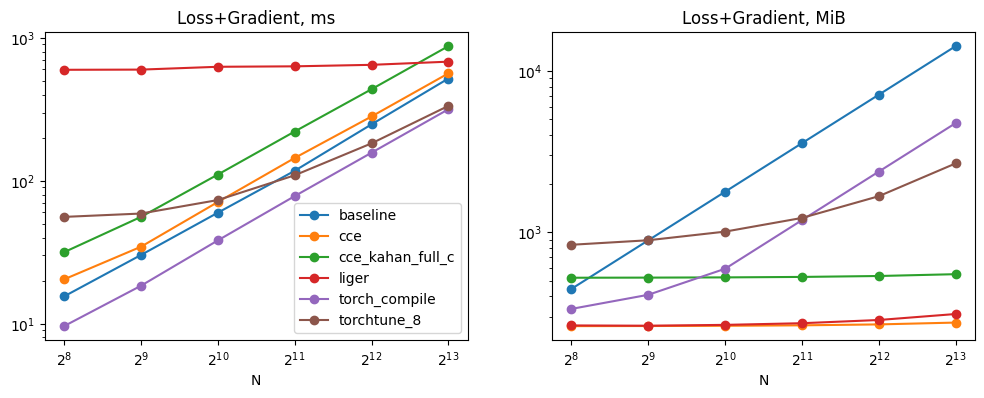
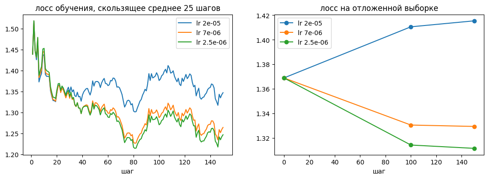
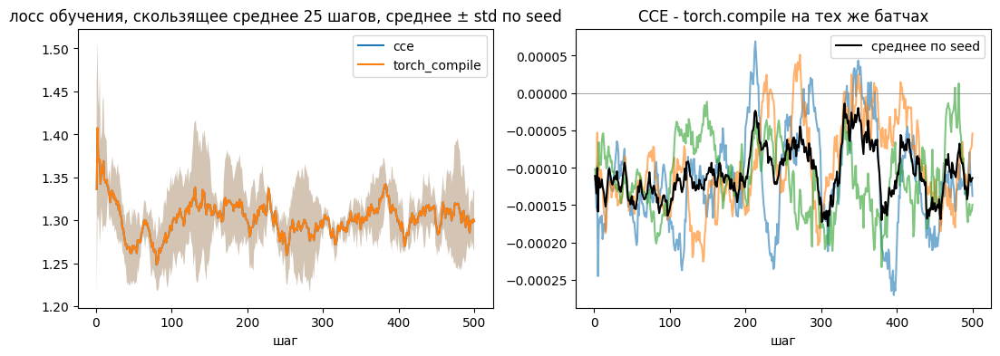

# Воспроизведение Cut Cross-Entropy на Tesla T4

Отчёт о воспроизведении статьи «Cut Your Losses in Large-Vocabulary Language Models» (Wijmans и др., Apple, ICLR 2025).

- Статья: [arXiv 2411.09009v2](https://arxiv.org/abs/2411.09009v2), [HTML-версия](https://arxiv.org/html/2411.09009v2) (ссылки на таблицы, рисунки и приложения ниже ведут в неё).
- Библиотека авторов: [ml-cross-entropy](https://github.com/apple-aiml-research/ml-cross-entropy).
- Ноутбуки: [01_loss_layer.ipynb](../notebooks/01_loss_layer.ipynb) (слой лосса), [02_training.ipynb](../notebooks/02_training.ipynb) (обучение).
- Журналы прогонов: [results/](../results/) (ноутбук 1), [results_training/](../results_training/) (ноутбук 2).

Все результаты получены на одной Tesla T4 (Kaggle) в fp16. Числа статьи помечены «из статьи», собственные вычисления «расчёт». Статья мерила на A100 в bf16 с Gemma 2 2B, воспроизведение выполнено на T4 в fp16 с Qwen2.5-0.5B-Instruct, поэтому сравниваются в основном отношения, а не абсолютные значения.

## 1. Краткие итоги

| Утверждение статьи | Результат на T4 | Статус |
|---|---|---|
| CCE не теряет точность градиента ([раздел 4.3](https://arxiv.org/html/2411.09009v2#S4.SS3)) | критерий тестов авторов выполнен в 63 из 63 случаев | воспроизводится |
| Память лосса падает до нижней границы ([таблица 1](https://arxiv.org/html/2411.09009v2#S5.T1)) | CCE 275.3 MiB при нижней границе 273.7 MiB, baseline 14 244 MiB | воспроизводится |
| CCE по скорости наравне с `torch.compile` ([таблица 1](https://arxiv.org/html/2411.09009v2#S5.T1)) | CCE медленнее в 1.76 раза | не воспроизводится |
| Softmax разрежен: вероятность ниже порога с ~50-го токена ([рис. 3](https://arxiv.org/html/2411.09009v2#S5.F3)) | ранг 54, доля ненулевых 0.026% | воспроизводится |
| Фильтрация и сортировка ускоряют обратный проход ([таблица 1](https://arxiv.org/html/2411.09009v2#S5.T1)) | сортировка 1.12x (в статье 1.15x), фильтрация 1.78x (в статье 3.14x) | частично |
| Удаление игнорируемых токенов ускоряет до 3 раз, кроме Liger ([приложение B](https://arxiv.org/html/2411.09009v2#A2)) | ускорение до 1.38 при 27% игнорируемых токенов; Liger тоже ускоряется | частично |
| Масштабирование по числу токенов ([рис. A1-A2](https://arxiv.org/html/2411.09009v2#A5.F1)) | качественная картина совпадает | воспроизводится |
| Выигрыш CCE по времени падает с уменьшением \|V\|/D ([раздел 5.1](https://arxiv.org/html/2411.09009v2#S5.SS1)) | тренд обратный, память у нижней границы | не воспроизводится (память да) |
| Кривые лосса CCE и `torch.compile` неразличимы ([рис. 4](https://arxiv.org/html/2411.09009v2#S5.F4)) | разница 0.0001 при разбросе между seed 0.018 | воспроизводится |
| Батч растёт в 1.5-10 раз без потери скорости ([рис. 1](https://arxiv.org/html/2411.09009v2#S1.F1)) | батч 9 -> 109 (12.1x), пропускная способность ниже на 9-15% | частично |

Экономия памяти и сохранение сходимости воспроизводятся количественно. Скорость CCE на T4 не воспроизводится: ядра Triton на этой архитектуре медленнее, чем cuBLAS, на котором работает `torch.compile`.

## 2. Постановка задачи

При обучении языковой модели последний слой строит матрицу логитов N x |V|. Остальные затраты памяти уже сокращены (checkpointing, ZeRO, FlashAttention), поэтому у моделей с большим словарём основную память при обучении занимает именно лосс: по оценке авторов для Gemma 2 2B это 89%, а одно только вычисление лосса для батча 8 192 токена занимает 24 ГБ (из статьи, [раздел 3.2](https://arxiv.org/html/2411.09009v2#S3.SS2), [таблица 1](https://arxiv.org/html/2411.09009v2#S5.T1)).

В воспроизведении словарь Qwen2.5 |V| = 151 936, батч N = 8 192 токена. Логиты в fp32 занимают 8 192 · 151 936 · 4 Б = 4 748 MiB (расчёт). Обычная реализация на PyTorch (baseline) для лосса с градиентом занимает 14 244 MiB, то есть три такие матрицы, при объёме T4 14 912 MiB (ноутбук 1, раздел 1.2).

Задача работы: проверить утверждения статьи с помощью библиотеки авторов, без собственных ядер, на доступном оборудовании, одной T4 с 16 ГБ памяти.

## 3. Условия воспроизведения

### 3.1 Оборудование и версии

Данные из `results/setup/env.json` (ноутбук 1, раздел 1.0):

| | |
|---|---|
| GPU | Tesla T4 (Kaggle), compute capability 7.5 (Turing), 40 SM, 16 ГБ |
| Python, CUDA | 3.11.17, 12.1 |
| torch / Triton | 2.5.1+cu121 / 3.1.0 |
| transformers / datasets | 4.48.2 / 5.0.1 |
| cut-cross-entropy | 25.9.3, коммит `3de376c` |
| liger-kernel / bitsandbytes | 0.5.10 / 0.50.2 |

Окружение ставит [`scripts/setup_oldstack.sh`](../scripts/setup_oldstack.sh) в отдельный venv.

### 3.2 Почему такие версии

Библиотека авторов требует GPU Ampere или новее ([README](https://github.com/apple-aiml-research/ml-cross-entropy/blob/main/README.md?plain=1#L18)), а T4 относится к предыдущему поколению Turing. Версии подобраны так, чтобы ядра CCE на T4 работали и использовали тензорные ядра:

- **Triton 3.1.** Начиная с Triton 3.3 матричное умножение `tl.dot` для GPU с compute capability ниже 8.0 не использует тензорные ядра и выполняется на обычных FMA ([`AccelerateMatmul.cpp`, v3.3.0](https://github.com/triton-lang/triton/blob/v3.3.0/lib/Dialect/TritonGPU/Transforms/AccelerateMatmul.cpp#L285-L289)). На Triton 3.1 в скомпилированных ядрах CCE есть инструкции `mma`: 32 в прямом проходе и 160 в обратном (ноутбук 1, раздел 1.0), то есть тензорные ядра используются.
- **Не Triton 3.2.** Библиотека сама предупреждает, что с Triton 3.2 CCE может давать неверные градиенты ([`linear_cross_entropy.py`](https://github.com/apple-aiml-research/ml-cross-entropy/blob/main/cut_cross_entropy/linear_cross_entropy.py#L169-L176)).
- **torch 2.5.1.** Последний выпуск PyTorch, который ставит Triton 3.1: в зависимостях torch 2.5.1 указан `triton==3.1.0`, в torch 2.6.0 уже `triton==3.2.0` ([PyPI](https://pypi.org/project/torch/2.5.1/)).
- **transformers 4.48.2.** Версия закреплена в [`pyproject.toml`](https://github.com/apple-aiml-research/ml-cross-entropy/blob/main/pyproject.toml#L19-L21) авторов.
- **liger-kernel 0.5.10 и bitsandbytes 0.50.2.** Особых причин нет, это версии, совместимые с этим стеком, на которых получены результаты.

### 3.3 Адаптация ядер под T4

Форма блоков в библиотеке зафиксирована: 128 x 128 x 32, 4 варпа, 4 стадии конвейера ([`_cce_best_config`](https://github.com/apple-aiml-research/ml-cross-entropy/blob/main/cut_cross_entropy/tl_autotune.py#L489-L490)). Turing поддерживает не больше двух стадий (см. [код авторов](https://github.com/apple-aiml-research/ml-cross-entropy/blob/main/cut_cross_entropy/tl_autotune.py#L235-L237)), а shared memory на блок у T4 64 КБ против 164 КБ у A100.

Код библиотеки не изменялся. Форма блоков навешана на ядра через `triton.heuristics`, и её можно подменить после импорта ([`t4_patch.py`](../src/cce_repro/t4_patch.py)); прямой и обратный проходы получают одну форму. В ноутбуке 1 (раздел 1.0) перебраны 24 формы с двумя стадиями: B ∈ {32, 64, 128} x V ∈ {32, 64, 128, 256} x {4, 8} варпа. Результат:

- 6 форм не компилируются: 128 x 128 требует 83 968 Б shared memory, 64 x 256 требует 98 304 Б, 128 x 256 требует 163 840 Б при лимите 65 536 Б. Среди них и авторская 128 x 128.
- Остальные 18 проходят проверку против fp32 (|Δloss| < 1e-2, косинус dE и dC больше 0.999).
- Выбрана самая быстрая: 64 x 64 x 32, 4 варпа, 2 стадии, 553.4 ms на Loss+Gradient при N = 8 192. Пять лучших форм укладываются в 4.1% (553-576 ms), так что выбор формы на выводы не влияет.

### 3.4 fp16 вместо bf16

T4 не поддерживает bf16 аппаратно, поэтому все замеры идут в fp16. Следствия:

- ниже порог фильтрации градиента. CCE пропускает блок, если все |S - onehot| в нём меньше порога ε ([раздел 4.3](https://arxiv.org/html/2411.09009v2#S4.SS3)). В библиотеке ε по умолчанию равен машинному эпсилону типа, делённому на 32 ([`_handle_eps`](https://github.com/apple-aiml-research/ml-cross-entropy/blob/main/cut_cross_entropy/utils.py#L19-L27)): 2^-12 для bf16, как в статье, и 2^-15 для fp16, то есть в 8 раз ниже (раздел 4.3);
- при обучении нужен GradScaler (масштабирование лосса против потери малых градиентов): пропущено около 0.3% шагов из-за переполнения.

### 3.5 Модель и данные

- Модель Qwen2.5-0.5B-Instruct: |V| = 151 936, D = 896, 24 слоя. Матрица классификатора у неё связана с входными эмбеддингами (`tie_word_embeddings`), поэтому градиент по C при обучении попадает и во входной слой.
- Данные Alpaca ([yahma/alpaca-cleaned](https://huggingface.co/datasets/yahma/alpaca-cleaned)) в чат-шаблоне модели.
- Как у авторов, E берётся из настоящей модели, а не из случайных чисел: выход последнего слоя на примерах Alpaca. Кэш 40 960 токенов ответа (5 непересекающихся окон по 8 192) и 40 960 токенов вместе с промптом, из них 27.2% с меткой -100 (не участвуют в лоссе). Для раздела 4.6 эмбеддинги дополнительно взяты из Qwen2.5-1.5B и 3B.

### 3.6 Методика

- **Память и время.** Замер повторяет [`benchmark`](https://github.com/apple-aiml-research/ml-cross-entropy/tree/main/benchmark) авторов ([`measure.py`](../src/cce_repro/measure.py)). Память - прирост пика выделенной памяти за операцию; входы E и C в него не входят, созданные градиенты входят. Поэтому для Loss+Gradient нижняя граница равна размеру ∇E и ∇C: (8 192 + 151 936) · 896 · 2 Б = 273.7 MiB (расчёт). Время меряется событиями CUDA, среднее по итерациям после прогревочного вызова; итераций до 20, меньше, если один вызов долгий.
- **Повторы.** Таблица 1 (раздел 1.2) усредняется по 5 непересекающимся окнам токенов, замеры разделов 1.3-1.6 по 3 повторам.
- **Режимы.** Loss - только прямой проход, Gradient - только обратный, Loss+Gradient - оба.
- **Критерии.** Для каждого эксперимента критерий сформулирован до прогона и записан в ноутбуке в разделе «Что делается».

## 4. Слой лосса (ноутбук 1)

### 4.1 Корректность

**Статья.** CCE ускоряет обратный проход без потери точности градиента ([раздел 4.3](https://arxiv.org/html/2411.09009v2#S4.SS3)).

**Что сделано.** Взят критерий из тестов авторов ([`tests/test_cce_loss_backward.py`](https://github.com/apple-aiml-research/ml-cross-entropy/blob/main/tests/test_cce_loss_backward.py)): для каждого элемента |gt - x| ≤ |gt - ref| + 1e-3, где gt - расчёт в fp32, ref - обычный PyTorch в fp16, x - проверяемый метод. Проверены loss, dE и dC у 9 методов (все варианты CCE и `torch.compile`) в 7 случаях: три формы из тестов авторов с игнорируемыми токенами и без, и настоящие эмбеддинги Qwen (N = 2 048). Отдельно проверены `shift=1` и детерминизм.

| | Статья | T4 |
|---|---|---|
| точность градиентов | без потерь (из статьи) | критерий выполнен в 63 из 63 случаев |
| относительная ошибка dE против fp32, реальные данные | - | CCE 1.95%, `cce_exact` 2.22%, `torch.compile` 0.98% |
| относительная ошибка dC против fp32 | - | 0.22-0.24% у всех |
| относительная ошибка лосса против fp32 | - | 4.4e-5 у вариантов CCE, 3.8e-5 у `torch.compile` |

- `shift=1` на входе (B, T, D) совпадает с ручным сдвигом побитово.
- Детерминизма нет: в трёх одинаковых запусках лосс совпадает побитово, а dE и dC различаются (разброс dC до 6.0e-4 относительно нормы). Причина в атомарных сложениях: порядок суммирования меняется от запуска к запуску. Статья детерминизм не заявляет.
- Ошибка dE 1.95% у CCE, CCE с порогом bf16 и всех вариантов Kahan; 2.22% у `cce_exact`, CCE без фильтрации и CCE без сортировки. У варианта без сортировки фильтрация включена, а ошибка 2.22%, значит, разницу определяет порядок суммирования, а не фильтрация. Фильтрация точность не ухудшает.

**Вывод.** Утверждение о точности воспроизводится в смысле тестов авторов. Ошибка dE у CCE в fp16 примерно вдвое выше, чем у `torch.compile`, но укладывается в критерий.

### 4.2 Память и время (таблица 1)

**Статья.** [Таблица 1](https://arxiv.org/html/2411.09009v2#S5.T1): Gemma 2 2B, N = 8 192, A100. CCE сокращает память лосса с 24 ГБ до 1 МБ, а память слоя классификатора с градиентом с 28 ГБ до 1 ГБ, по скорости CCE наравне с `torch.compile` (из статьи).

**Что сделано.** Те же 10 методов в трёх режимах, N = 8 192, 5 окон токенов. Критерии: память CCE в пределах 1% от нижней границы; варианты Kahan (с буферами суммирования Кэхэна для ∇E и ∇C) около двух нижних границ; порядок методов по памяти как в статье. Время сравнивается отношениями к `torch.compile`.

Отношения по Loss+Gradient:

| Метод | Статья: память / нижн. граница | T4 | Статья: время / `torch.compile` | T4 |
|---|---|---|---|---|
| CCE | 1.003 | 1.006 | 1.01 | 1.76 |
| Liger | 1.27 | 1.14 | 2.13 | 2.13 |
| torchtune, 8 чанков | 8.3 | 9.8 | 1.18 | 1.04 |
| `torch.compile` | 13.8 | 17.4 | 1.00 | 1.00 |
| baseline | 24.1 | 52.1 | 1.45 | 1.63 |
| CCE без сортировки | 1.001 | 1.004 | 1.11 | 1.89 |
| CCE без фильтрации | 1.001 | 1.002 | 2.50 | 2.61 |
| CCE-Kahan | 2.003 | 2.007 | 1.12 | 1.98 |
| CCE-Kahan-FullC | 2.003 | 2.007 | 2.19 | 2.71 |
| CCE-Kahan-FullE | 2.003 | 2.007 | 2.04 | 2.63 |

Абсолютные значения на T4 (Loss+Gradient): CCE 275.3 MiB / 562.8 ms, `torch.compile` 4 748 MiB / 320.1 ms, baseline 14 244 MiB / 522.5 ms. Только лосс: CCE 0.6 MiB против 11 870 MiB у baseline (в статье 1 MB против 24 000 MB, из статьи).

По памяти выполнены все три критерия:
- CCE на 0.59% выше нижней границы;
- варианты Kahan занимают 2.01 нижней границы;
- порядок методов по памяти совпадает со статьёй (ранговая корреляция 1.00).

Отношение baseline к нижней границе на T4 больше (52 против 24): логиты растут как N · |V|, а нижняя граница как (N + |V|) · D, и у Qwen2.5-0.5B D = 896 в 2.6 раза меньше, чем у Gemma 2 2B (расчёт). Ещё одно следствие (расчёт): `torch.compile` в Loss+Gradient занимает ровно одну матрицу логитов в fp32 (4 748 MiB), baseline три (14 244 MiB).

Абсолютная память, зависящая только от N и |V|, совпадает со строками Qwen 2.5 7B из [таблицы A3](https://arxiv.org/html/2411.09009v2#A5.T3) (тот же словарь Qwen, |V| = 152 064 против 151 936 у Qwen2.5-0.5B; «MB» в таблицах статьи на самом деле MiB):

| | Статья (Qwen 2.5 7B, из статьи) | T4 |
|---|---|---|
| baseline, Loss | 11 880 | 11 870 |
| `torch.compile`, Loss | 2 376 | 2 374 |
| torchtune, Loss | 2 379 | 2 374 |
| baseline, Loss+Gradient | 14 256 | 14 244 |

Разница равна отношению размеров словарей (0.9992). Не совпадает только `torch.compile` в Loss+Gradient: 9 504 в статье против 4 748 на T4; возможно, из-за разных версий PyTorch (2.4.1 у авторов, 2.5.1 в воспроизведении), причина не проверена.

По времени у методов без CCE отношения к `torch.compile` близки к статье: Liger 2.13 против 2.13, чанки 1.04 против 1.18, baseline 1.63 против 1.45. CCE на T4 в 1.76 раза медленнее `torch.compile`, а в статье они наравне. Отставание есть уже в прямом проходе: 198.8 ms против 131.5 ms на T4, 46 ms против 49 ms в статье (из статьи). Прямой проход CCE - это матричное умножение с редукцией в LSE, поэтому дело в скорости ядер Triton на sm_75 с блоком 64 x 64 и двумя стадиями по сравнению с cuBLAS, а не в самом алгоритме. Kahan замедляет CCE в 1.12 раза (в статье 1.10).

Повторный прогон того же ноутбука на Colab (другая T4, те же версии) дал ту же память и отношения времени в пределах 0.12 (у CCE 1.79); журналы того прогона в репозиторий не входят.

**Вывод.** Экономия памяти воспроизводится количественно. Паритет по скорости с `torch.compile` на T4 не воспроизводится: CCE медленнее примерно в 1.8 раза.

### 4.3 Разреженность softmax и фильтрация

**Статья.** Средняя вероятность падает ниже порога 2^-12 примерно к 50-му по величине токену ([раздел 5.2](https://arxiv.org/html/2411.09009v2#S5.SS2), [рис. 3](https://arxiv.org/html/2411.09009v2#S5.F3)), ненулевых элементов меньше 0.02% ([раздел 4.3](https://arxiv.org/html/2411.09009v2#S4.SS3)). В [таблице 1](https://arxiv.org/html/2411.09009v2#S5.T1) без сортировки CCE медленнее на 15% (Gradient), без фильтрации в 3.14 раза (из статьи).

**Что сделано.** Построен аналог рисунка 3 на тех же 8 192 токенах, посчитаны доля ненулевых элементов |S - onehot| и доля блоков 64 x 64, которые пропускает фильтр, при двух порогах, с сортировкой словаря и без. Критерии: ранг пересечения 2^-12 в диапазоне 30-100; доля ненулевых 0.01-0.04%; эффекты фильтрации и сортировки в ту же сторону, что в статье.

*Рисунок 1. Средняя вероятность i-го по величине токена, логарифмические оси (ноутбук 1, раздел 1.3). Линии: пороги 2^-12 (bf16, статья) и 2^-15 (fp16, порог по умолчанию в воспроизведении).*

| | Статья (из статьи) | T4 |
|---|---|---|
| ранг, где средняя вероятность падает ниже 2^-12 | ~50 | 54 |
| доля ненулевых \|S - onehot\| при пороге 2^-12 | < 0.02% | 0.026% |
| то же при пороге 2^-15 (fp16) | - | ранг 183, 0.080% |
| без фильтрации / CCE, Gradient | 3.14 | 1.78 |
| без фильтрации / CCE, Loss+Gradient | 2.46 | 1.48 |
| без сортировки / CCE, Gradient | 1.15 | 1.12 |
| без сортировки / CCE, Loss+Gradient | 1.10 | 1.08 |

Доля пропускаемых блоков 64 x 64:

| Порог | С сортировкой | Без сортировки |
|---|---|---|
| 2^-12 (bf16) | 84.5% | 76.6% |
| 2^-15 (fp16) | 69.5% | 57.6% |

Время обратного прохода и Loss+Gradient при разных порогах: CCE с порогом 2^-15 364 / 563 ms, с порогом 2^-12 286 / 482 ms, без фильтрации 648 / 835 ms, `cce_exact` (без фильтрации, накопление в fp32) 862 / 1 053 ms.

Относительно `cce_exact` градиент dE у CCE отличается на 3.1% при обоих порогах, у варианта без фильтрации на 0.04%; dC у всех отличается примерно на 0.12%. Фильтр полностью обнуляет 0.05% строк dE, то есть 4 из 8 192 токенов (расчёт). При этом против fp32-эталона ошибка dE у CCE не больше, чем у `cce_exact` (раздел 4.1), то есть изменение, вносимое фильтром, того же порядка, что погрешность самого накопления в fp16.

Все три критерия выполнены.

**Вывод.** Разреженность softmax воспроизводится почти количественно. Эффект сортировки совпадает со статьёй (1.12 против 1.15). Эффект фильтрации тот же по направлению, но слабее (1.78 против 3.14). Причина в пороге: в fp16 библиотека берёт 2^-15, и пропускается 69.5% блоков вместо 84.5%. С порогом статьи 2^-12 вариант без фильтрации медленнее в 648 / 286 = 2.26 раза (расчёт).

### 4.4 Удаление игнорируемых токенов

**Статья.** Если выбросить токены, которые не участвуют в лоссе (промпт, паддинг), до подсчёта логитов, все методы, кроме Liger, ускоряются, вплоть до трёх раз ([приложение B](https://arxiv.org/html/2411.09009v2#A2), [таблица A1](https://arxiv.org/html/2411.09009v2#A2.T1)).

**Что сделано.** Данные с промптом, N = 8 192. Baseline, чанки и Liger считаются по всем токенам и с удалением игнорируемых до логитов. CCE и `torch.compile` в библиотеке удаляют их сами; они сравниваются с данными без промпта той же длины (раздел 4.2). В данных игнорируется 27.4% токенов, поэтому ускорение не может превысить 1 / (1 - 0.274) = 1.38 (расчёт).

Loss+Gradient, N = 8 192; в статье ускорение = таблица 1 / таблица A1 (из статьи):

| Метод | Как удаляются | Статья: ускорение | T4: ускорение | T4: память было / стало |
|---|---|---|---|---|
| baseline | до логитов | 2.77 | 1.39 | 1.38 |
| torchtune, 8 чанков | до логитов | 2.19 | 1.24 | 1.28 |
| Liger | до логитов | 1.00 | 1.36 | 0.98 |
| CCE | сам | 2.69 | 1.36 | 1.00 |
| `torch.compile` | сам | 2.70 | 1.38 | 1.37 |

- Удаление ускоряет baseline и чанки, CCE и `torch.compile` упираются в потолок 1.38.
- Liger на T4 тоже ускоряется (1.36), в отличие от статьи. Причина видна в коде Liger ([`fused_linear_cross_entropy.py`](https://github.com/linkedin/Liger-Kernel/blob/v0.5.10/src/liger_kernel/ops/fused_linear_cross_entropy.py), v0.5.10). Размер чанка равен next_power_of_2(ceil(BT / ceil(|V| / D))), где BT - число токенов, и на каждый чанк выполняется умножение, обновляющее всю матрицу dC размером |V| x D. Время Liger поэтому определяется числом чанков:
  - у Qwen2.5-0.5B ceil(|V| / D) = 170: при 8 192 токенах получается 128 чанков, после удаления (~5 950 токенов) 93, отношение 1.38 (расчёт);
  - у Gemma 2 2B ceil(|V| / D) = 112: при 8 192 токенах 64 чанка. Если после удаления остаётся около 36% токенов (оценка по ускорению baseline 2.77), чанков становится 93, то есть больше, чем до удаления (расчёт). Это объясняет отсутствие ускорения в статье. Сами авторы объясняют его тем, что Liger упирается в накладные расходы на запуск ядер.

**Вывод.** Ускорение от удаления игнорируемых токенов воспроизводится и ограничено долей таких токенов в использованных данных. «До трёх раз» в статье следует из большей доли игнорируемых токенов. Исключение для Liger не переносится: оно зависит от того, как меняется число чанков.

### 4.5 Масштабирование по числу токенов

**Статья.** По [рисункам A1-A2](https://arxiv.org/html/2411.09009v2#A5.F1) и [приложению C.2](https://arxiv.org/html/2411.09009v2#A3.SS2):
- CCE масштабируется так же, как baseline и `torch.compile`;
- у CCE нет накладных расходов чанкинга;
- CCE-Kahan-FullC медленнее Liger и torchtune при большом числе токенов, но быстрее при малом.

**Что сделано.** N от 256 до 8 192, шесть методов, 3 повтора. Критерии: время CCE, baseline и `torch.compile` растёт линейно; Kahan-FullC быстрее Liger и чанков при малом N и медленнее при большом.

*Рисунок 2. Время (слева) и память (справа) Loss+Gradient в зависимости от числа токенов N, логарифмические оси (ноутбук 1, раздел 1.5).*

Loss+Gradient, ms:

| N | CCE | `torch.compile` | baseline | Чанки | Liger | Kahan-FullC |
|---|---|---|---|---|---|---|
| 256 | 20.4 | 9.6 | 15.5 | 55.8 | 597.1 | 31.6 |
| 1 024 | 70.9 | 38.2 | 59.7 | 73.2 | 626.8 | 110.4 |
| 4 096 | 281.5 | 157.0 | 247.9 | 182.5 | 646.8 | 436.7 |
| 8 192 | 563.8 | 316.2 | 518.9 | 333.8 | 680.7 | 874.4 |

- Рост линейный: время(8 192) / время(4 096) у CCE 2.00, у baseline 2.09, у `torch.compile` 2.01. Отношение CCE / `torch.compile` от 1.8 до 2.1 на всём диапазоне.
- Накладных расходов чанкинга у CCE нет: при N = 256 CCE считает за 20.4 ms, чанки за 55.8 ms.
- Kahan-FullC при N = 256 быстрее Liger и чанков (31.6 ms против 597 и 55.8 ms), при N = 8 192 медленнее (874 ms против 681 и 334 ms).
- Liger держится около 600 ms при любом N: при всех N чанков почти всегда 128 (раздел 4.4), и каждый обновляет всю dC.
- Память CCE почти не зависит от N (от 262 до 275 MiB), у baseline и `torch.compile` растёт линейно.

Все критерии выполнены.

**Вывод.** Качественная картина масштабирования воспроизводится полностью. Отличие одно: постоянный множитель около 1.8 между CCE и `torch.compile` из раздела 4.2.

### 4.6 Отношение |V| / D

**Статья.** Чем меньше отношение размера словаря к размерности D, тем меньше у CCE выигрыш по времени Loss+Gradient, при этом экономия памяти остаётся ([раздел 5.1](https://arxiv.org/html/2411.09009v2#S5.SS1), [таблица A3](https://arxiv.org/html/2411.09009v2#A5.T3)).

**Что сделано.** Эмбеддинги трёх моделей Qwen2.5 с одним словарём и разной D: 0.5B (D = 896), 1.5B (1 536), 3B (2 048); бэкбон 3B для извлечения эмбеддингов в fp16, остальные в fp32. CCE, `torch.compile` и baseline при N = 8 192. Критерии: отношение времени CCE / `torch.compile` растёт при уменьшении |V| / D; память CCE у нижней границы.

| Модель | \|V\| / D | CCE / `torch.compile`, время Loss+Gradient | Память CCE / нижн. граница |
|---|---|---|---|
| Qwen2.5-0.5B (T4) | 170 | 1.76 | 1.006 |
| Qwen2.5-1.5B (T4) | 99 | 1.55 | 1.003 |
| Qwen2.5-3B (T4) | 74 | 1.53 | 1.002 |
| Gemma 2 2B (из статьи) | 111 | 1.01 | - |
| Gemma 2 9B (из статьи) | 71 | 1.01 | - |
| Gemma 2 27B (из статьи) | 56 | 1.10 | - |
| Qwen 2.5 7B (из статьи) | 42 | 1.12 | - |
| Phi 3.5 Mini (из статьи) | 10 | 1.55 | - |

Абсолютное время Loss+Gradient на T4: CCE 557 / 852 / 1 108 ms, `torch.compile` 316 / 548 / 724 ms. Baseline в этом эксперименте не поместился в память на обратном проходе ни для одной модели: не хватило от 20 до 440 MiB. В разделе 4.2 тот же замер занимает 14 244 MiB из 14 912 MiB, а здесь перед замером в том же процессе загружался и выгружался бэкбон. На критерии это не влияет.

- Критерий по времени не выполнен: отношение не растёт, а падает (1.76, 1.55, 1.53).
- Критерий по памяти выполнен у всех трёх моделей.

В статье при |V| / D от 42 до 111 отношение меняется слабо (1.01-1.12), до 1.55 оно доходит только при |V| / D = 10, так что диапазон воспроизведения 74-170 лежит там, где эффект статьи почти не виден. Авторы объясняют тренд двумя причинами ([приложение C.2](https://arxiv.org/html/2411.09009v2#A3.SS2)):
- число токенов с заметным градиентом примерно постоянно, поэтому при меньшем |V| фильтр отбрасывает меньшую долю;
- параллелизм CCE равен N · |V| и с ростом D не растёт, а у остальных методов растёт.

Первой причины в воспроизведении нет, словарь один и тот же. Вторая на T4 не работает: при N = 8 192 и блоке 64 x 64 ядро CCE запускает 128 · 2 374 = 303 872 блока на 40 SM (расчёт), параллелизма хватает при любом D. Гипотеза, отдельно не проверенная: с ростом D у ядер CCE растёт доля матричного умножения на тензорных ядрах относительно постоянных накладных расходов на блок (экспонента, фильтр, атомарные сложения).

**Вывод.** Экономия памяти при разных D воспроизводится. Тренд по времени не воспроизводится: в исследованном диапазоне |V| / D статья предсказывает почти постоянное отношение, а на T4 его определяет отставание ядер, а не |V| / D.

## 5. Обучение (ноутбук 2)

### 5.1 Сходимость при дообучении

**Статья.** При дообучении на Alpaca кривые лосса CCE и `torch.compile` неразличимы, то есть фильтрация градиента не мешает сходимости ([раздел 5.3](https://arxiv.org/html/2411.09009v2#S5.SS3), [рис. 4](https://arxiv.org/html/2411.09009v2#S5.F4): Qwen 2.5 7B, Phi 3.5 Mini, Gemma 2 2B, Mistral NeMo, среднее по 5 seed).

**Что сделано.** Полное дообучение Qwen2.5-0.5B-Instruct на Alpaca: CCE против `torch.compile`, 3 seed, 500 шагов, батч 8 последовательностей до 512 токенов. Остальное как в [`training/train.py`](https://github.com/apple-aiml-research/ml-cross-entropy/blob/main/training/train.py) авторов (HF Trainer): системный промпт и шаблон Alpaca, в лосс идёт только ответ, AdamW без weight decay, прогрев 5% шагов (25) и линейный спад lr до нуля, клиппинг градиента 1.0. Gradient checkpointing, fp16 autocast и GradScaler. При одном seed оба метода видят одни и те же батчи. Каждые 100 шагов считается лосс на отложенной выборке из 256 примеров, одинаково для обоих методов (логиты в fp32). Критерий: разница средних лоссов методов на последних 100 шагах меньше разброса между seed.

Отличия от постановки статьи, которые на одной T4 не устранить:

| | Статья ([`training/train.py`](https://github.com/apple-aiml-research/ml-cross-entropy/blob/main/training/train.py)) | Воспроизведение |
|---|---|---|
| модели | Qwen 2.5 7B, Phi 3.5 Mini, Gemma 2 2B, Mistral NeMo | Qwen2.5-0.5B-Instruct |
| точность | веса и вычисления в bf16 | fp32-веса, fp16 autocast, GradScaler |
| батч | 64 последовательности, 1 эпоха | 8 последовательностей, 500 шагов |
| длина | без обрезки | до 512 токенов (обрезается около 2% примеров) |
| внимание | FlashAttention 2 | SDPA (FlashAttention 2 не поддерживает T4) |
| seed | 5 | 3 |

У авторов пиковый lr 2e-5 при батче 64. Первый прогон ноутбука с 8-bit AdamW и постоянным lr 2e-5 дал рост лосса у обоих методов: на отложенной выборке с 1.354 до 1.49 (журналы того прогона в репозиторий не входят). Поэтому перед полным прогоном lr выбирается короткой проверкой: `torch.compile`, seed 0, первые 150 шагов того же расписания при lr 2e-5, 7e-6 (масштабирование с батча 64 на 8 по корню) и 2.5e-6 (линейное масштабирование). Правило выбора зафиксировано до прогона: среди lr, при которых лосс на отложенной выборке на шаге 150 ниже, чем на шаге 0, берётся lr с наименьшим лоссом.

*Рисунок 3. Проверка lr: лосс обучения (скользящее среднее 25 шагов) и лосс на отложенной выборке за 150 шагов (ноутбук 2, раздел 2.1).*

| lr | Отложенная выборка, шаг 0 | Шаг 150 | Снижается |
|---|---|---|---|
| 2e-5 | 1.3689 | 1.4154 | нет |
| 7e-6 | 1.3689 | 1.3293 | да |
| 2.5e-6 | 1.3689 | 1.3115 | да |

Выбран lr 2.5e-6, то есть 2e-5 · 8 / 64.

*Рисунок 4. Слева: лосс обучения, скользящее среднее 25 шагов, среднее и стандартное отклонение по 3 seed (кривые CCE и `torch.compile` совпадают). Справа: разность лоссов CCE и `torch.compile` на одних и тех же батчах по каждому seed (ноутбук 2, раздел 2.1).*

| | Статья | T4 |
|---|---|---|
| кривые лосса CCE и `torch.compile` | неразличимы (из статьи) | на тех же батчах средняя разность CCE - `torch.compile` равна -0.00011 (0.02% от лосса), максимум по 3 000 шагов 0.0014 |
| последние 100 шагов, среднее по seed | - | 1.3024 против 1.3025: разница 0.0001 при разбросе между seed 0.018 |
| лосс на отложенной выборке | - | 1.3689 на шаге 0, 1.3031 против 1.3032 на шаге 500; разница по всем seed и шагам не больше 7e-5 |
| время шага, батч 8 | - | CCE 1.163 s, `torch.compile` 1.121 s: CCE на 3.7% медленнее |
| пик памяти, батч 8 | - | 9 450 и 9 449 MiB |

- Критерий выполнен с запасом примерно в 150 раз.
- Модель учится: лосс на отложенной выборке монотонно падает с 1.369 до 1.303. Лосс обучения, усреднённый по 100 шагам, почти постоянен (1.29-1.31): основное снижение приходится на первые ~50 шагов, дальше его перекрывает разница между батчами.
- На одних и тех же батчах лосс обучения у CCE ниже примерно на 1e-4 при всех трёх seed (95%-интервал среднего ±1.5e-5). На отложенной выборке, где лосс обоих методов считается одинаково в fp32, разница в среднем 2.4e-5, в 4 раза меньше. Значит, основная часть сдвига в том, как каждый метод считает сам лосс в fp16, а не в траектории обучения.
- В первом прогоне с 8-bit AdamW лосс рос, но CCE и `torch.compile` совпадали так же (разница 0.0001 при разбросе 0.021).
- Шаг обучения с CCE длиннее на 3.7%, хотя сам слой лосса медленнее в 1.76 раза (раздел 4.2): лосс занимает малую часть шага. При батче 8 логиты не определяют пик памяти, и он у методов практически одинаковый. Авторы для Phi 3.5 Mini, где слой лосса CCE медленнее `torch.compile` примерно на 50%, оценивают замедление обучения в 1-2% (из статьи, [приложение C.2](https://arxiv.org/html/2411.09009v2#A3.SS2)).

**Вывод.** Утверждение статьи воспроизводится: кривые CCE и `torch.compile` неразличимы, фильтрация градиента сходимости не мешает.

### 5.2 Максимальный батч

**Статья.** CCE позволяет увеличить батч в 1.5-10 раз без потерь в скорости и сходимости ([рис. 1](https://arxiv.org/html/2411.09009v2#S1.F1)). Числа [таблицы A4](https://arxiv.org/html/2411.09009v2#A5.T4) не замерены, а рассчитаны по формуле [приложения D](https://arxiv.org/html/2411.09009v2#A4) для 16 GPU по 80 ГБ, 65 536 токенов, bf16 и checkpointing: например, Gemma 2B 14.9x, Gemma 2 2B 9.5x (из статьи).

**Что сделано.**
- Замер на T4: полный шаг обучения с checkpointing, последовательности по 512 токенов, все токены в лоссе (как в формуле). Максимальный батч ищется удвоением и бинарным поиском для стандартного лосса transformers (`hf`), `torch.compile` и CCE, каждый в отдельном процессе. Критерий: кратный рост батча с CCE.
- Пропускная способность на найденном максимуме или, если повторные шаги на нём не помещаются, на батче до 20% меньше.
- Формула приложения D: проверяется на строке Gemma 2 2B, применяется к Qwen2.5-0.5B в постановке статьи, её члены сравниваются с наклоном пика памяти по батчу. Критерий: формула согласуется с замером.

Отличия от рисунка 1: одна T4 вместо 16 x 80 ГБ; 8-bit AdamW (его состояния занимают 942 MiB вместо 3 769 MiB в fp32, расчёт); веса в fp32, поэтому и сохранённые активации в fp32 (в формуле bf16).

| | `hf` | `torch.compile` | CCE |
|---|---|---|---|
| максимальный батч, последовательностей | 9 | 29 | 109 |
| то же, токенов | 4 608 | 14 848 | 55 808 |
| рост относительно `hf` | 1.0 | 3.2 | 12.1 |
| пик памяти на максимуме, MiB | 13 598 | 13 054 | 12 730 |
| пропускная способность, токен/с (батч) | 3 088 (9) | 3 302 (29) | 2 810 (94) |
| наклон пика, MiB на токен (замер) | 2.12 | 0.72 | 0.16 |

| | Статья (из статьи) | Расчёт |
|---|---|---|
| формула для Gemma 2 2B, максимум токенов до -> после | 1 108 206 -> 10 580 057 | 1 108 206 -> 10 580 056 |
| формула для Qwen2.5-0.5B, рост батча | - | 15.1x |

- Критерий роста батча выполнен: 12.1x, внутри диапазона [таблицы A4](https://arxiv.org/html/2411.09009v2#A5.T4). Батч упирается не только в выделенную память: на максимуме пик 12 730-13 598 MiB из 14 912 MiB, а следующий батч падает из-за фрагментации; у `hf` поиск нашёл 10, но повторная проверка прошла только на 9. Первый прогон ноутбука дал те же максимальные батчи 9, 29 и 109 (журналы того прогона в репозиторий не входят).
- На максимальном батче CCE обрабатывает на 9% меньше токенов в секунду, чем `hf`, и на 15% меньше, чем `torch.compile`. Скорость CCE измерена на батче 94: на 109 повторные шаги не поместились в память. Это следствие отставания ядер CCE на T4 (раздел 4.2).
- На строке Gemma 2 2B расчёт совпадает с таблицей A4 до одного токена. Для Qwen2.5-0.5B формула даёт 15.1x против замеренных 12.1x, то есть сходится по порядку величины. Критерий согласия выполнен частично: члены формулы на токен отличаются от замера в 2-3.7 раза, и отличия частично компенсируют друг друга.
  - `hf`: 2.12 MiB на токен, в 3.7 раза больше 0.58 MiB логитов в fp32, которые учитывает формула. По-видимому, transformers держит одновременно несколько копий логитов (fp16, fp32 для лосса, softmax, градиент); по отдельности это не измерялось. Авторы сами пишут, что формула, вероятно, занижает память логитов.
  - `torch.compile`: 0.72 MiB, около 1.25 размера логитов в fp32.
  - CCE: 0.16 MiB. Логитов нет, остаются сохранённые активации (0.08 MiB в fp32 в воспроизведении против 0.04 MiB в bf16 в формуле) и прочие буферы.

**Вывод.** Экономия памяти даёт кратный рост батча и на одной T4: 12.1x против 3.2x у `torch.compile`. Утверждение «без потери скорости» на T4 воспроизводится частично: пропускная способность на максимальном батче ниже на 9-15%.

## 6. Что не воспроизвелось и почему

| Расхождение | Причина |
|---|---|
| CCE в 1.76 раза медленнее `torch.compile` (в статье наравне) | отставание есть уже в прямом проходе, то есть дело в ядрах Triton на sm_75: блок 64 x 64 и 2 стадии вместо 128 x 128 и 4 стадий, против cuBLAS у `torch.compile`. Авторы сами отмечают, что в Triton управление потоком возможно только на уровне блока, и реализация на CUDA могла бы быть быстрее ([раздел 6](https://arxiv.org/html/2411.09009v2#S6)) |
| фильтрация ускоряет обратный проход в 1.78 раза, а не в 3.14 | в fp16 порог по умолчанию 2^-15 вместо 2^-12, и пропускается 69.5% блоков вместо 84.5%; с порогом 2^-12 ускорение 2.26 |
| удаление игнорируемых токенов ускоряет до 1.38, а не до 3 | в данных игнорируется 27.4% токенов, отсюда потолок 1.38 |
| Liger ускоряется от удаления токенов (в статье нет) | время Liger определяется числом чанков, а оно зависит от \|V\| / D и числа токенов по-разному для Qwen и Gemma |
| отношение CCE / `torch.compile` падает с уменьшением \|V\| / D, а не растёт | диапазон воспроизведения \|V\| / D (74-170) лежит там, где эффект статьи почти не виден, а на T4 отношение определяет скорость ядер |
| градиенты CCE недетерминированы | атомарные сложения в обратном проходе; статья детерминизм не заявляет |
| пропускная способность CCE на максимальном батче ниже на 9-15% | то же отставание ядер на T4 |

## 7. Что не проверялось

- Предобучение ([рис. 5](https://arxiv.org/html/2411.09009v2#S5.F5)): CCE-Kahan-FullC против `torch.compile` на OpenWebText требует бюджета, недоступного на одной T4.
- Разбивка обратного прохода по компонентам ([таблица A2](https://arxiv.org/html/2411.09009v2#A3.T2)): для неё нужно выборочно отключать части ядра.
- Модели из [таблицы A3](https://arxiv.org/html/2411.09009v2#A5.T3) крупнее 3B: их бэкбон не помещается в T4 даже для извлечения эмбеддингов.
- Рисунок 1 в постановке 16 x 80 ГБ: проверен только расчётом по формуле приложения D (логиты, активации, веса с градиентами и состояниями оптимизатора).

## 8. Расхождения внутри статьи

- Часть чисел в тексте не совпадает с [таблицей 1](https://arxiv.org/html/2411.09009v2#S5.T1) (расчёт по таблице):
  - [раздел 4.3](https://arxiv.org/html/2411.09009v2#S4.SS3): фильтрация даёт ускорение «3.5x»; [раздел 5.1](https://arxiv.org/html/2411.09009v2#S5.SS1): без фильтрации CCE медленнее «в 3.4 раза (356 ms)». По таблице без фильтрации обратный проход медленнее в 314 / 100 = 3.14 раза, Loss+Gradient в 357 / 145 = 2.46 раза.
  - Без сортировки CCE медленнее «на 15% (23 ms)». По таблице 15% и 15 ms для Gradient (115 против 100 ms), 10% и 14 ms для Loss+Gradient.
  - CCE считает лосс быстрее `torch.compile` «на 5% (4 ms)», по таблице 46 против 49 ms, то есть на 6% и 3 ms.
  - CCE медленнее в Loss+Gradient «на 6% (2 ms)», по таблице 145 против 143 ms, то есть на 1.4%.
- В [таблице A3](https://arxiv.org/html/2411.09009v2#A5.T3) у Qwen 2.5 7B и 32B память `torch.compile` в Loss+Gradient (9 504) совпадает с памятью baseline в режиме Gradient (9 504); на T4 `torch.compile` в Loss+Gradient занимает 4 748 MiB. Причина не проверена.
- Все значения памяти в таблицах статьи подписаны «MB», но это MiB: нижняя граница таблицы 1, (8 192 + 256 000) · 2 304 · 2 Б, равна 1 161 MiB (расчёт), как в таблице.

## 9. Выводы

1. Главное утверждение статьи воспроизводится на T4 количественно: CCE считает лосс и градиент, занимая память на уровне нижней границы (275.3 MiB против 273.7 MiB), тогда как обычная реализация занимает 14 244 MiB.
2. Точность градиента сохраняется (критерий тестов авторов выполнен везде), а сходимость при дообучении от CCE не меняется: разница с `torch.compile` в 150 раз меньше разброса между seed.
3. Экономия памяти даёт рост максимального батча в 12.1 раза при обучении на одной T4.
4. Паритет по скорости не воспроизводится: на T4 CCE примерно в 1.8 раза медленнее `torch.compile`, потому что ядра Triton на Turing работают с урезанной формой блоков и медленнее cuBLAS. При обучении это заметно слабее: шаг длиннее на 3.7%, пропускная способность на максимальном батче ниже на 9-15%.
5. Чтобы библиотека заработала на T4, нужны старый стек (torch 2.5.1, Triton 3.1) и уменьшенная форма блоков; выбор конкретной формы на результаты не влияет.
6. Работа в fp16 вместо bf16 ослабляет фильтрацию градиента: порог по умолчанию становится в 8 раз ниже, и ускорение от фильтрации меньше, чем в статье.

## 10. Как воспроизвести

1. Открыть [01_loss_layer.ipynb](../notebooks/01_loss_layer.ipynb) в Kaggle или Colab с GPU T4 (на Kaggle включить доступ в интернет) и выполнить ячейки по порядку. Ячейка подготовки клонирует [репозиторий](https://github.com/SaylesMand/Efficient-Models-HWs), скрипт `setup_oldstack.sh` ставит окружение. Результаты пишутся построчно в `results_loss_layer/` рядом с репозиторием; после обрыва сессии достаточно перезапустить ячейку.
2. Так же выполнить [02_training.ipynb](../notebooks/02_training.ipynb). В Colab результаты и чекпоинты пишутся на Google Drive, и дообучение после обрыва продолжается с последнего чекпоинта (каждые 100 шагов); на Kaggle результаты пишутся в `results_training/`.
3. Код экспериментов лежит в [src/cce_repro](../src/cce_repro/); отдельный эксперимент запускается командой `python -m cce_repro.run <эксперимент>`.
